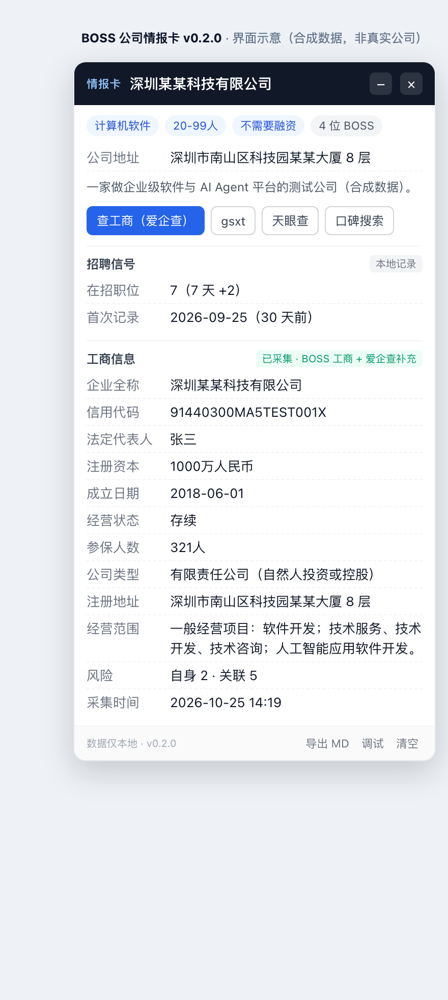

# Company Intel Card · 公司情报卡

> 在 BOSS 直聘的公司页 / 职位详情页注入一张「公司情报卡」，把 **公司信息 + BOSS 自带工商信息 + 招聘信号** 聚合到一处。
>
> 只读当前页已渲染的 DOM：**不新增网络请求、不调用 BOSS 接口、不读 cookie、不自动翻页、不上架**。
>
> ⚠️ 非官方工具，与 BOSS 直聘无任何关联。仅用于个人求职决策辅助。



`v0.2.0` ｜ 许可证 [MIT](LICENSE) ｜ 仅限个人求职辅助

---

## 功能

| 能力 | 说明 |
|---|---|
| 公司页情报卡 | 公司名 / 行业 / 规模 / 融资阶段 / 在招职位数 / 招聘者数 / 地址 / 简介 |
| BOSS 自带工商信息 | 公司页读 15 个字段：信用代码、法定代表人、注册资本、成立日期、经营状态、公司类型、注册地址、营业期限、所属地区、登记机关、经营范围等；职位页读 6 个字段 |
| 招聘信号 | 在招职位数快照与变化、公司首次记录时间、职位首次见到时间、职位是否已关闭 |
| 列表页记录 | 静默记录你滚动到的职位（`encryptJobId → firstSeenAt`），薪资自动解码 BOSS 的 PUA 字体反爬 |
| 公司全部职位页 | `/gongsi/job/{id}.html` 记录全部在招职位 |
| 爱企查半自动补充 | 你点按钮打开爱企查 → 点一次「采集并回填」→ 补充 BOSS 没有的参保人数 / 实缴 / 风险 |
| 导出 | 当前公司画像导出 Markdown 到剪贴板；职位记录导出 JSON |
| 调试模式 | 页面改版导致字段为空时，一键复制解析结果与页面文本块 |

**明确不做**：批量采集、后台请求接口、绕过验证码/登录态、采集 HR 姓名/手机号/简历、自动投递、上架应用商店。

---

## 安装

### 1. 安装用户脚本管理器

- Chrome / Edge：安装 [Tampermonkey](https://www.tampermonkey.net/)
- Firefox：Tampermonkey / Violentmonkey 均可

### 2. 安装本脚本

- **方式 A（推荐）**：在 Tampermonkey 中新建脚本，粘贴 [`company-intel-card.user.js`](company-intel-card.user.js) 全部内容，保存。
- **方式 B**：把 `.user.js` 文件拖进浏览器窗口，按提示安装。

### 3. Chrome 138+ 必须多开一个开关

Chrome 新版本对使用 `userScripts` API 的扩展有额外限制，**不打开这个开关脚本不会执行**：

1. 地址栏打开 `chrome://extensions/?id=dhdgffkkebhmkfjojejmpbldmpobfkfo`
2. 页面向下，找到 **「允许用户脚本」（Allow User Scripts）**，打开
3. 刷新 BOSS 页面

### 4. 验证

打开任意公司页（`zhipin.com/gongsi/*.html`）或职位详情页（`zhipin.com/job_detail/*.html`），右下角应出现「情报卡」。

> 搜索结果列表页（`/web/geek/jobs`）**不会出完整卡片**，只在左下角显示「已记录 N 个职位」的小提示条——这是设计，不挡职位列表。

---

## 使用

### 公司页 `/gongsi/{id}.html`

- 自动出卡：基本信息 + BOSS 自带 15 字段工商 + 招聘信号。
- 每次打开记录一次在招职位数快照，显示如 `7（7 天 +2）`。
- 「查工商（爱企查）」只补 BOSS 没有的字段（参保人数 / 实缴 / 风险）。
- 「gsxt / 天眼查 / 口碑搜索」只做跳转，不抓取；gsxt 会先复制公司名。
- 「导出 MD」把公司画像复制到剪贴板。

### 职位详情页 `/job_detail/{id}.html`

- 当前职位（职位名 / 薪资 / 城市 / 是否已关闭）+ 公司信息 + 6 字段工商。
- 显示「该职位首次见到」时间（依赖你在列表页滚过它）。

### 搜索列表页 `/web/geek/jobs`

- 左下角小提示条：已记录职位数、本页数量、新增数量；可导出 JSON 或隐藏。
- 只记录你自己滚动出来的卡片，**不会自动翻页**。

### 公司全部职位页 `/gongsi/job/{id}.html`

- 记录全部在招职位；该页 `.boss-name` 实际是 HR，脚本会排除，不采集。

### 爱企查页面

从 BOSS 点「查工商」过来的 **30 分钟内**，爱企查公司详情页底部会出现采集条；点「采集并回填」即可。

---

## 它是怎么工作的

```
BOSS 页面（你自己登录、自己浏览）
   │  页面自己发请求、自己渲染 DOM
   ▼
油猴脚本（document-idle 注入）
   ├─ 路由识别：公司页 / 职位页 / 列表页 / 公司全部职位页 / 爱企查
   ├─ 只读 DOM 解析（选择器 + 标签-值解析 + 正则兜底）
   ├─ Shadow DOM 悬浮卡（不修改页面原有 DOM）
   ├─ 本地存储：GM_setValue（公司 / 职位 / 配置）
   └─ 导出：Markdown 复制 / JSON 下载
```

- **零网络请求**：脚本内没有 `fetch` / `XHR` / `GM_xmlhttpRequest`，也不读 cookie。
- **SPA 适配**：每 500ms 检查路由变化；公司页/职位页在 0.8s / 2s / 4.5s / 8s 重试解析，应对前端异步渲染。
- **本地存储键**：`bci:company:*`、`bci:jobs`、`bci:lastQuery`（均在 Tampermonkey 存储内，仅本机）。
- **公司键**：优先 `encryptBrandId`，没有时退化为公司名；同名公司可能混淆，卡片会标注来源。

---

## 数据来源与边界

| 来源 | 用途 | 状态 |
|---|---|---|
| BOSS 页面 DOM | 公司信息、招聘信号、**自带工商 15/6 字段** | 主力，已真机验证 |
| 爱企查 | 补充参保人数 / 实缴 / 风险 | 半自动，需要手动点一次 |
| gsxt / 天眼查 / 小红书 | 深链跳转 | 不抓取 |
| 看准网 | 曾是评价数据源 | 2024-09-30 已关站，不再提供 |

**评价维度**（员工评价/口碑）没有稳定免费来源，脚本只提供小红书等搜索入口，不自动抓取。

---

## 已知限制 / 常见问题

**Q：装了但右下角没有卡片？**

1. 确认 Tampermonkey 已启用本脚本；
2. 确认 Chrome 的「允许用户脚本」已打开（见安装第 3 步）；
3. 刷新页面；
4. 确认你在公司页或职位详情页，而不是搜索结果页。

**Q：工商信息显示「未采集」？**

- 列表页没有工商区块；进公司页/职位页才会读取。首次进入某公司页时可能还没合并完整字段，再进一次即可。

**Q：列表页薪资是乱码？**

- 脚本会把 BOSS 的 PUA 字体字符解码为正常数字；如果全部解不出，说明 BOSS 换了字体映射，会退回显示原文，需要更新映射表。

**Q：页面改版导致字段为空？**

- 点卡片「调试」复制解析结果（含页面文本块），按 README 的「选择器修复」逻辑更新 `extract*` 函数。

**其他限制**：

- 只支持 BOSS 直聘网页版（`www.zhipin.com`），其他招聘站未适配；
- 公司名消歧依赖 `encryptBrandId`，没有时可能同名混淆；
- 爱企查尚未做真实 DOM 校准，使用的是通用标签解析。

---

## 隐私

- **只在本机运行**：所有数据存 Tampermonkey 本地存储，不上传。
- **不采集**：HR 姓名/头像/手机号、聊天记录、简历、cookie。
- **可清空**：卡片「清空」清当前公司；Tampermonkey 菜单「清空本扩展数据」清全部。
- **不读取登录凭证**：脚本不碰 cookie/localStorage 里的登录态。

---

## 开发与测试

```bash
npm install
npm test
```

- 68 项本地测试（jsdom）：公司页、职位页、列表页、公司全部职位页、爱企查提取与回填、PUA 薪资解码、公司键策略、脏 DOM 解析、Markdown 导出。
- 仓库结构：

```
company-intel-card/
├── company-intel-card.user.js   # 用户脚本（单文件，无构建）
├── README.md
├── LICENSE
├── preview.png                  # 合成数据界面示意
├── package.json
├── test/run-tests.mjs
└── .github/workflows/test.yml
```

测试只覆盖逻辑与 DOM 注入，不能替代真实页面验证。

---

## 路线

- `v0.2.0`（当前）：公司页/职位页卡片、BOSS 自带工商、招聘信号、PUA 薪资解码、爱企查半自动。
- 后续：爱企查真实 DOM 校准；多平台口碑搜索菜单（牛客/脉脉/职友集/黑猫投诉）；社区名单本地匹配；CSV 导出。
- 不做：服务端爬虫、批量后台请求、自动投递、绕过验证码/登录态。

---

## 免责声明

- 本项目为**非官方**个人工具，与 BOSS 直聘及其关联方无任何关系。
- 数据来自用户自己浏览器中已渲染的页面，可能存在缺失、延迟或被平台改版影响，**不保证准确性**。
- 请遵守目标网站的用户协议与 robots 规则；**禁止用于批量采集、商业转售、绕过技术措施或任何违法用途**。
- 使用本工具产生的账号风控、数据丢失等风险由使用者自行承担。
- 本项目仅提供工具，不提供、不托管任何抓取数据。

## License

[MIT](LICENSE) © 2026 dongxuanmang
